# Описание работы · ТЗ № 08 · «ЛЕПЕСТОК 24»

**Исполнитель:** Кладити Дмитрий, группа 11/1-РПО-26/1
**Сайт:** https://tz08masterskayalepestok24.vercel.app
**Период проверок:** 30.10.2026

## 1. Задача заказчика

Компания «ЛЕПЕСТОК 24» получает заявки из  Instagram и Telegram, но не знает, какой канал приводит
клиентов. В праздничные недели было 300 обращений, потеряно 120 (письмо директора в ТЗ).
Задача — сайт, на котором видно источник каждого посетителя, и одна
таблица со всеми заявками.

## 2. Схема работы

Схема работы 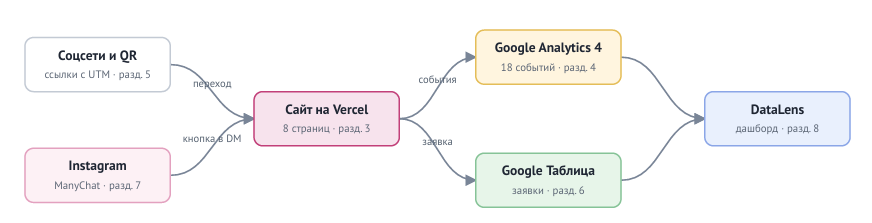

Посетитель приходит из соцсетей или по QR-коду по ссылке с UTM-метками.
Сайт отправляет события в GA4, а заявку — в Google Таблицу через Apps Script.

## 3. Сайт

Сайт из 8 страниц создан с помощью Cgat-GPT и доработан вручную.
Опубликован на Vercel, обновляется после каждого push.

Главная страница 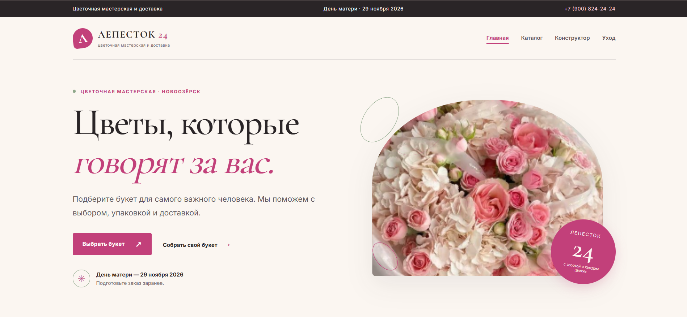
Сайт на телефоне, 375 px 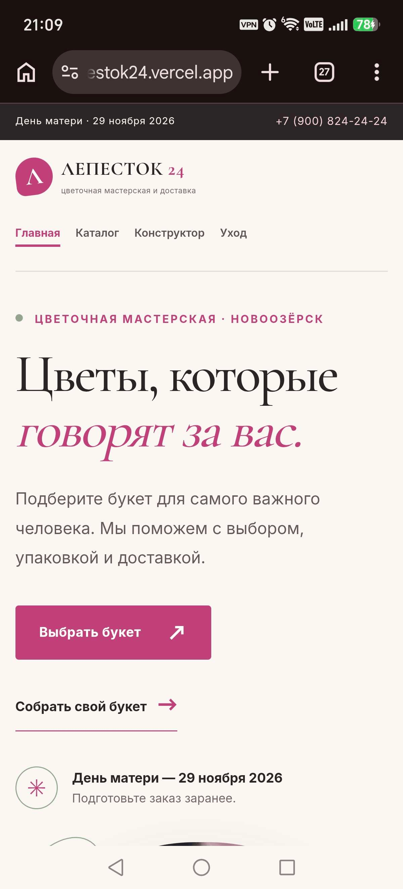
Lighthouse 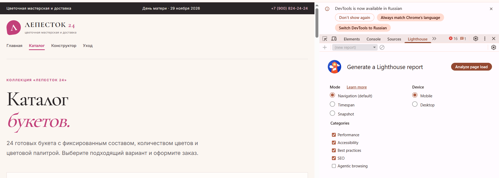

## 4. Аналитика GA4

Настроено 16 событий, из них своих — 10. Ключевые события: 3.
Каждое событие проверено в DebugView и RealTime.

События в DebugView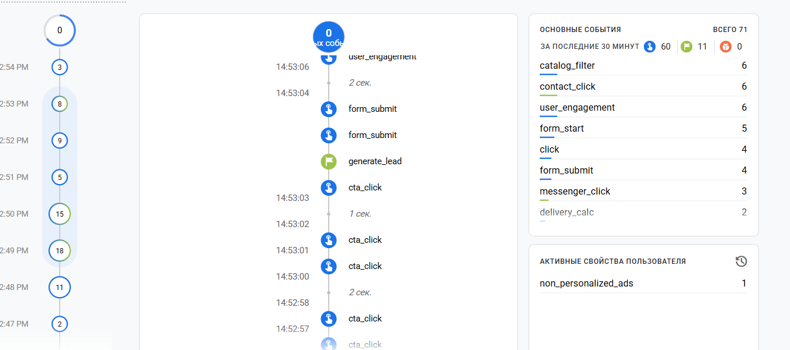
Пользовательские параметры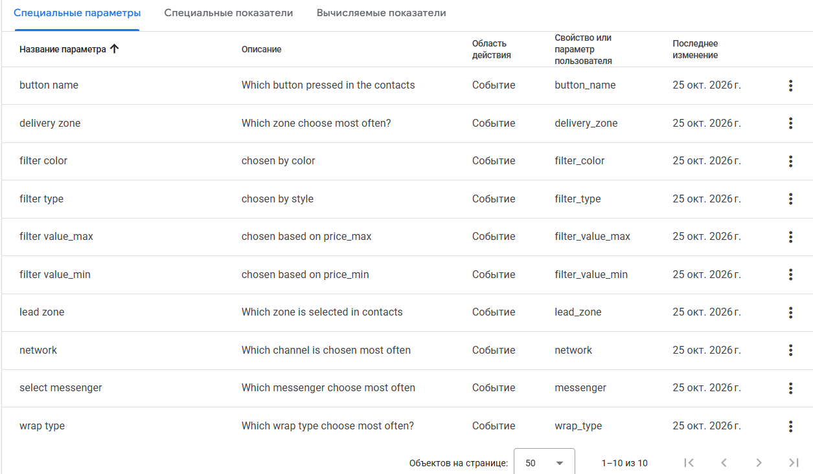

## 5. UTM-ссылки и соцсети

В реестре 5 ссылок. 3 тестовые, ссылка, зашитая в qr-код, и одна опубликованная в Instagram в reel с подключенным ManyChat.

Реестр ссылок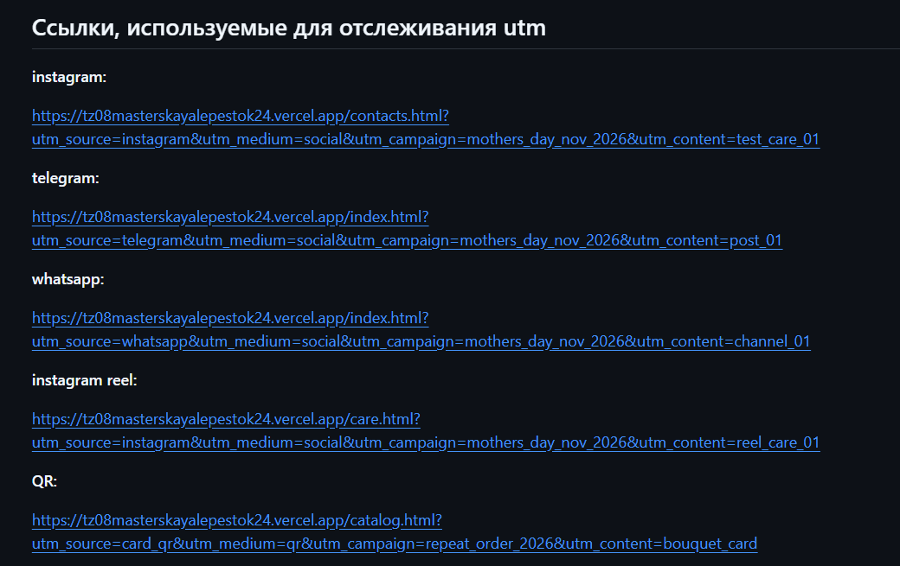
Источники в Traffic acquisition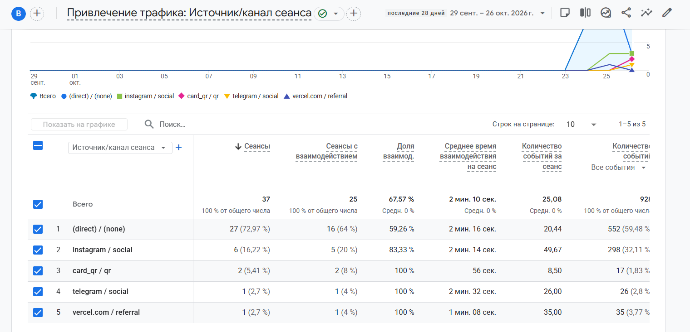 (Из гугл аналитики источник трафика)

## 6. Заявки

Форма отправляет заявку в Apps Script, тот проверяет поля и записывает
строку в лист `leads` вместе с метками. Повторная отправка не создаёт дубль.

Форма на сайте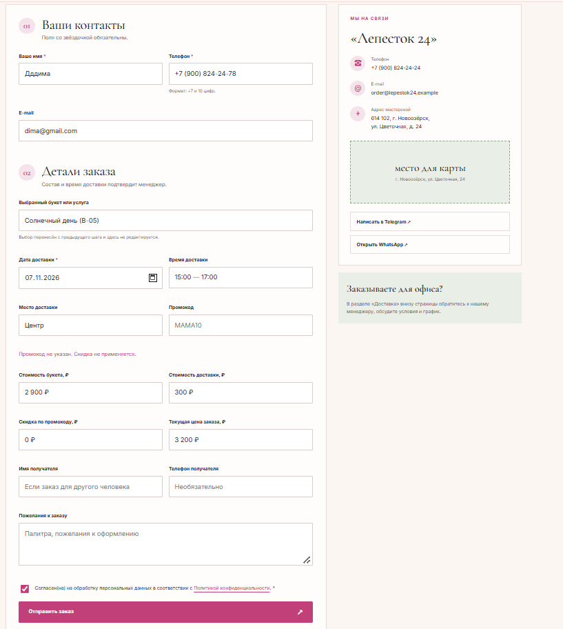
Заявка в таблице с метками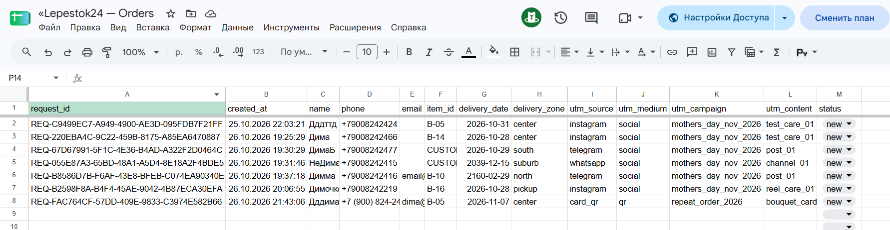

## 7. Автоответы в Instagram

Комментарий «УХОД» под Reel запускает ответ в комментариях и сообщение
в Direct с кнопкой на сайт. Вторая ветка — слово «ОФИС».

Ответ в комментариях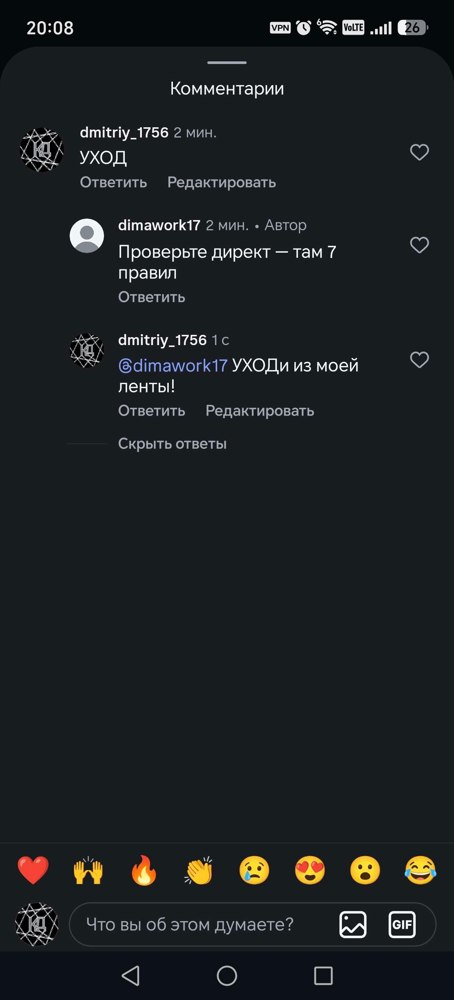
Сообщение в Direct с кнопкой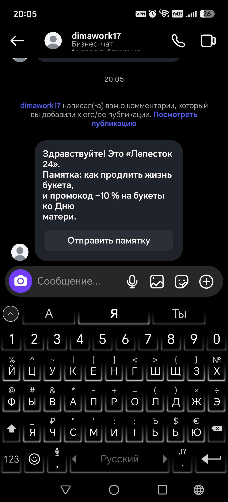

## 8. Отчёты и дашборд

Воронка показала наибольшую потерю между загрузкой каталога и оформлением доставки (75 %).
Больше всего заявок принёс канал instagram.

Воронка в Explore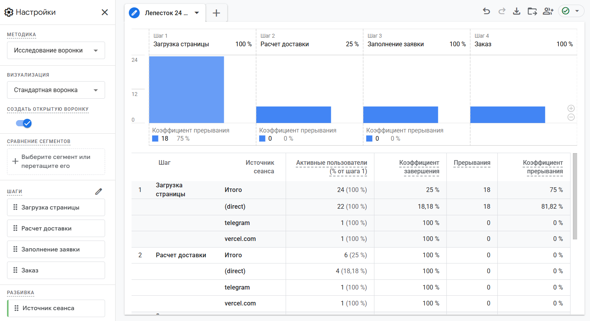

## 9. Что получил бизнес

| Было | Стало |
|---|---|
| заявки в личных сообщениях трёх аккаунтов | все заявки в одной таблице со статусом |
| источник клиента неизвестен | у каждой заявки есть source, medium, campaign |
| бюджет делится «по ощущениям» | на отчетах видно заявки по каждому каналу |
| ответы на комментарии вручную | ManyChat отвечает сразу и ведёт на сайт |

Рекомендация заказчику: переработать фотографии для более наглядно отображения товаров. Подготоаить несколько изображений для конструктора букетов, чтобы полььзователь понимал, какой, примерно, будет результат.

## 10. Итог

Не получилось: 
- Настроить дашборд в Yandex DataLens, так как ресурс работает нестабильно.
- Создать отчет key-events. Нужные события отмечены, но аналитика не может их отобразить их через филььтр ключевых событий.
- Открытие карточки букет и событие, отслеживающее это действие. Вся и иформация о букете полносьтю видна из каталога.
- Каналы мастерской (не связь, а именно каналы) не видны в подвале сайта, а только на странице с благодарностью. Как следствие событие social_click не отслеживает страницу, тольько сам факт перехода.
- Ошибка сруктуры: код всех событий написан в script.js а не в analytics.js.

Почему не получилось:

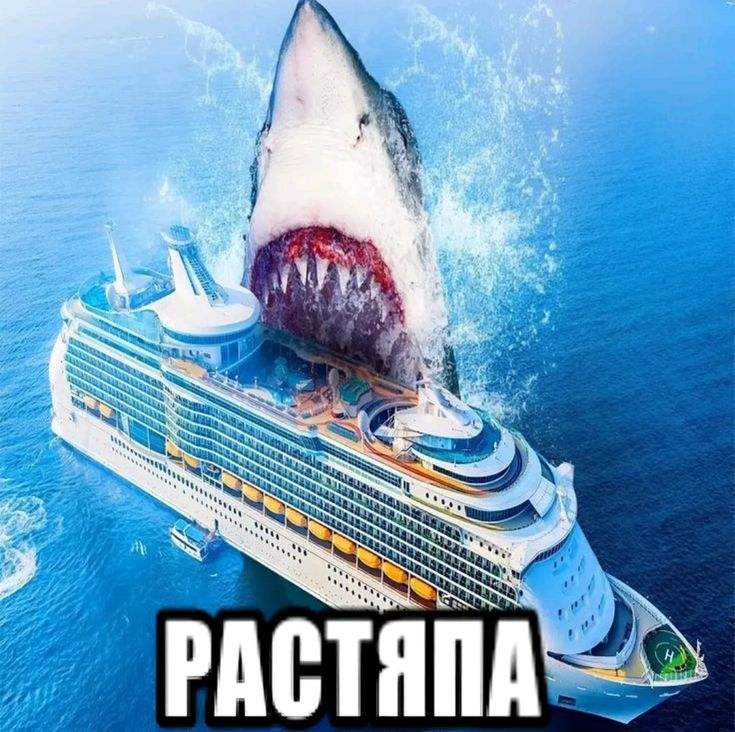

ИИ использовался для: создания кода основных страниц сайта, создания кода событий
