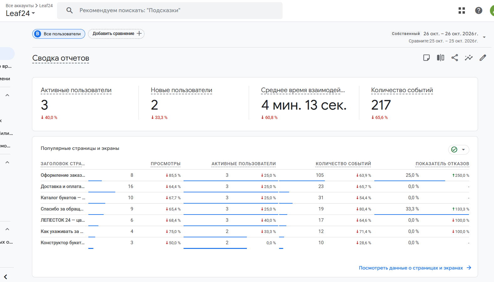
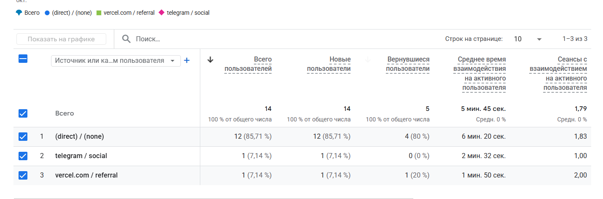
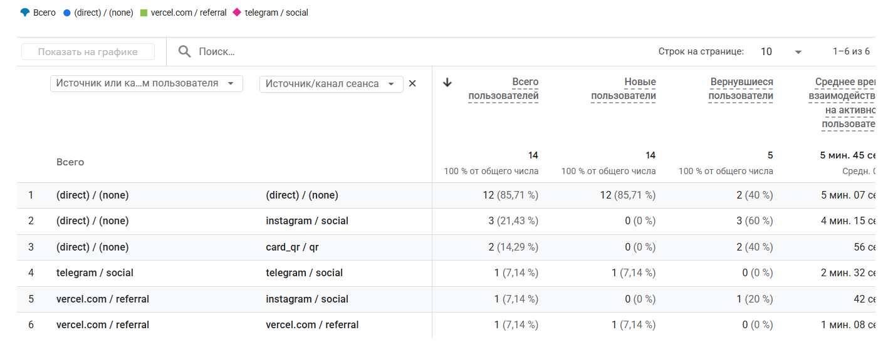
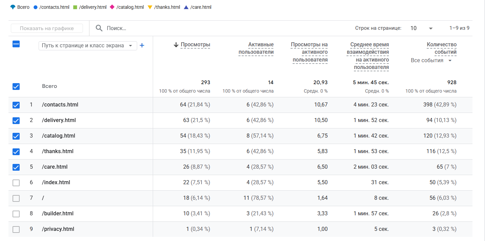
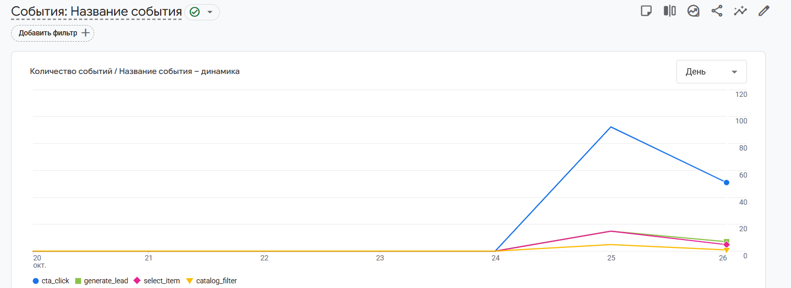
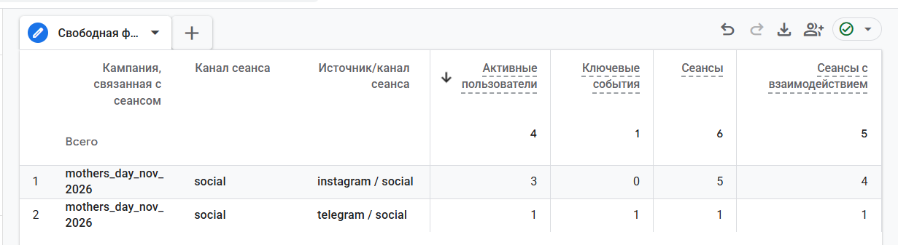
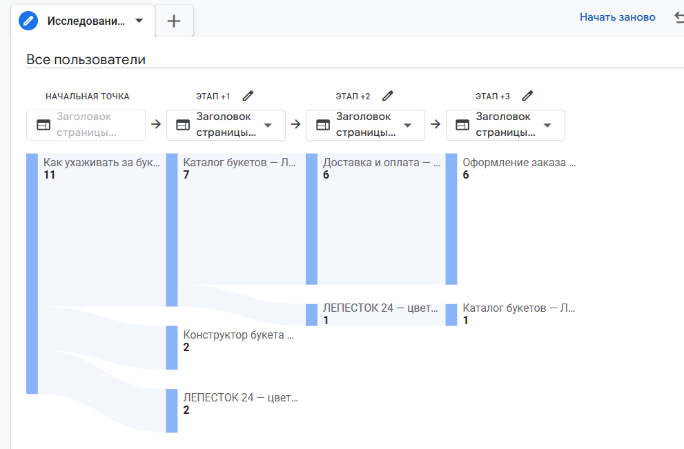

## Стандартные отчеты:

**Отчет периода проверок и сравнения с предыдущим периодом:**

**Отчет источника или канала с первым посещением полььзователя:**

**Отчет по источнику трафика с источник/канал сеанса:**

**Отчет по источнику трафика с компанией сеанса:**

**Отчет по странице, с которой пользователь начинает работу с сайтом и источнику перехода:**

**Отчет по страниицам и экранам:**

**Отчет по количеству событий (generate_lead, cta_click, catalog_filter, select_item):**

**Отчет по категории устройств:**

## Исследования:

**Свободная форма:**

**Воронка:**

**Путь:**

**Обратный путь:**

